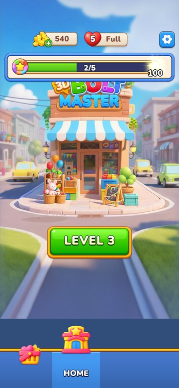
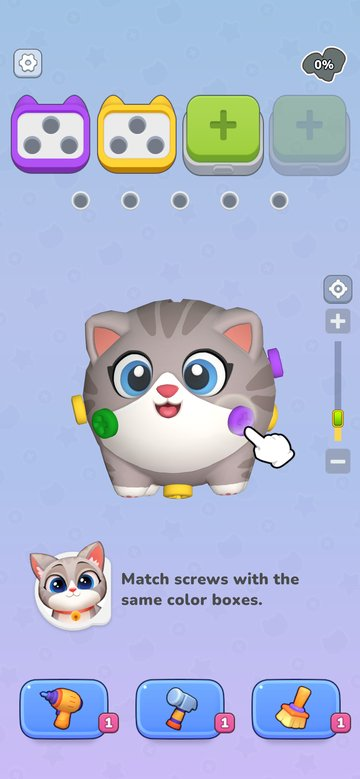
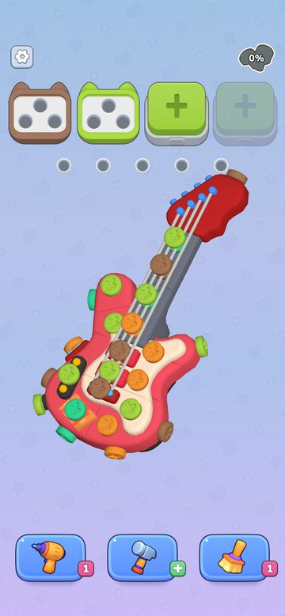
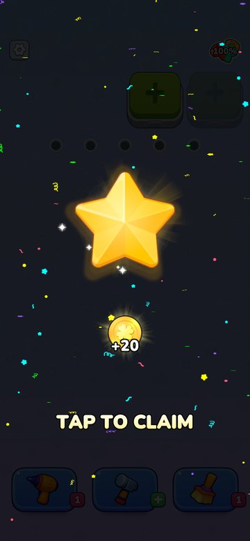
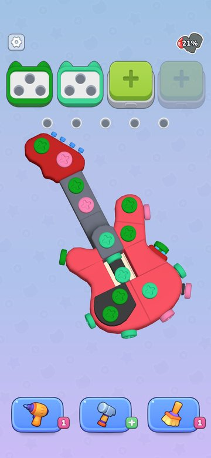
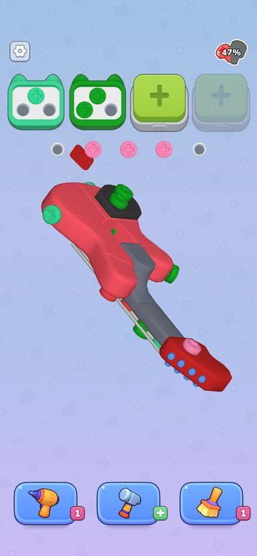
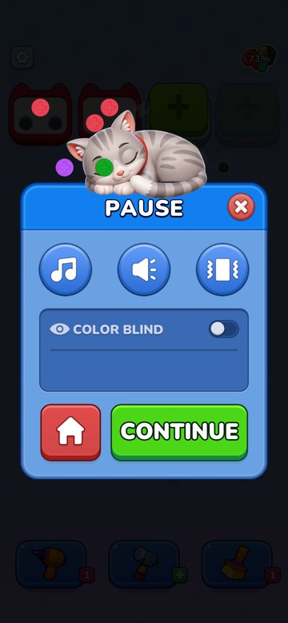
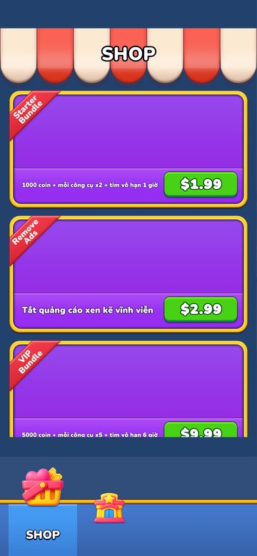
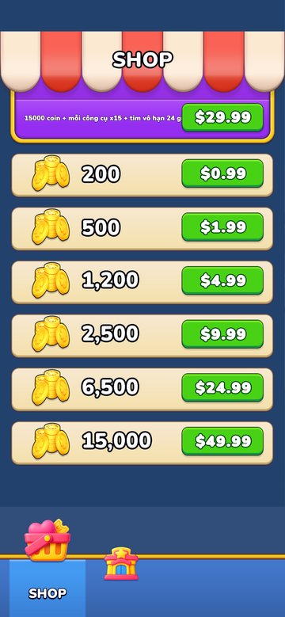

# Bolt Puzzle 3D

A 3D screw-sorting puzzle game made with **Unity 6 (URP)**. Rotate a 3D model, unscrew the bolts in the right order
and drop each one into a box of the same colour. Every box holds three screws. When the colour you need is not
on screen yet, park the screw in a holding hole, but don't let the holes fill up.

<p align="center">
  
  
  
  
</p>

## Gameplay

- **Rotate and zoom:** drag to rotate the model. Pinch, or use the vertical zoom slider, to zoom. The focus button
  puts the model back in the centre.
- **Colour boxes:** boxes arrive in a queue at the top. A screw goes into the open box of its colour, and a full box
  (three screws) flies away.
- **Holding holes:** a screw with no matching box waits in a hole. If every hole fills up, the level is lost.
- **Plates fall:** once every screw holding a plate is out, the plate drops away and opens the parts behind it.
- **80 levels.** After the last level the game loops back from level 11.

<p align="center">
  
  
  
</p>

## Features

| Feature | Description |
| --- | --- |
| Boosters | **Drill** adds a holding hole, **Hammer** breaks a plate, **Broom** clears the holes. Each has a Spine animation. When you run out, tap the booster to buy more with coins. |
| Extra box slots | Open another box slot with coins. When you lose, the game offers to add a box so you can keep going. |
| Lives | Hearts refill over time. Some rewards give unlimited lives for a set time. |
| Level chest | A chest every 5 levels, with coins and a booster. |
| Daily gift | 7-day check-in (Day 7 holds two rewards), plus milestone gifts at 10, 12, 16, 22 and 30 days in total. The Home button shows a countdown. |
| Shop | Coin packs and bundles through Unity IAP. |
| Tutorial | A guided level 1: a hand points at the screws, then shows how to rotate the model. |
| Settings | Music, sound and vibration. Opens with a slide animation. |
| Responsive | Fills portrait phones. On wide screens (desktop web) it shows a centred 9:16 column. |

<p align="center">
  
  
</p>

## Tech stack

- **Unity 6000.2.10f1**, Universal Render Pipeline 17.2
- uGUI + TextMeshPro, **DOTween** (tweens), **Spine 4.1** (booster and UI animations), UniTask, UIParticle, Unmask
- **Unity IAP 5.0.4**
- Targets: Android / iOS, plus **WebGL** with a custom responsive template (`Assets/WebGLTemplates/Responsive`)

## Project structure

```text
Assets/
├── _Game/
│   ├── Scenes/          SplashScene → HomeScene → GameScene
│   ├── Scripts/
│   │   ├── Core/        Managers, UserData (save), Inventory, Ads
│   │   ├── Gameplay/    GameController, GameCreator (level loading + colouring), Board, Screw, Box, Hole,
│   │   │                rotate / zoom gestures, boosters (ToolBase), tutorial
│   │   ├── Home/        Home page, navigation, level chest, daily gift, settings
│   │   ├── Dialogs/     Win / Fail / Pause / Buy item / Daily gift dialogs
│   │   ├── IAP/         Catalog + IapManager
│   │   ├── UI/          Dialog system, toasts, buttons
│   │   ├── Audio/       Music, SFX, vibration
│   │   └── Editor/      Build helpers
│   ├── Prefabs/         Levels (puzzle prefabs), UI, dialogs
│   ├── Resources/       GameConfig.asset (levels, prices, rewards, sprites)
│   └── Art2D / Art3D / Audio / UIKit / Particles / Shaders
└── WebGLTemplates/Responsive
Docs/                    README images
tools/                   auto_commit.sh
```

Most tuning lives in **`Assets/_Game/Resources/GameConfig.asset`**: level list and loop point, starting holes and box slots,
booster price, win reward, revive prices, chest interval and the sprites.

## Getting started

1. Open the project with **Unity 6000.2.10f1** (Unity Hub ▸ Add ▸ select this folder).
2. Open `Assets/_Game/Scenes/SplashScene.unity` and press **Play**. A phone resolution such as 1080×1920 in the Game
   view works best.

## Building for the web

1. **File ▸ Build Profiles ▸ Web ▸ Build**.
2. Upload the entire output folder. Replace the whole `Build/` folder each time.

The web build uses the custom template `Assets/WebGLTemplates/Responsive`: full screen on phones, and a centred
9:16 column with a loading bar on desktop.
